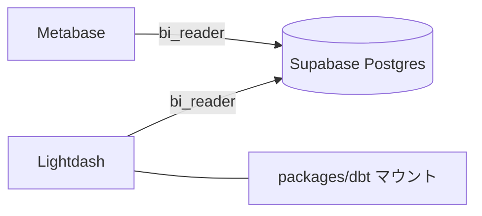

# Lightdash（dbt 連携 BI）

関連: [supabase-runtime.md](./supabase-runtime.md), [metabase.md](./metabase.md), [overview.md](./overview.md)

手順: [../operations/lightdash-setup.md](../operations/lightdash-setup.md)

---

## 1. 役割分担

| ツール | 向いていること |
|--------|----------------|
| **Metabase** | 地図、ad-hoc SQL、`raw_vault` の探索 |
| **Lightdash** | `packages/dbt` のモデル・`meta` メトリクスを軸にしたダッシュボード |

倉庫の接続・権限は [metabase.md](./metabase.md) §3–5 と同じ **`bi_reader`**（`mart` / `business_vault` / `raw_vault` の `SELECT` のみ）。位置データは Data API に出さない。

## 2. 配置

Lightdash も Supabase の外のプロセス。Supabase 側は引き続き `bi_reader` と Vault のみ。

| もの | 置き場 |
|------|--------|
| Lightdash アプリ DB | Compose の `lightdash-db`（pgvector）ボリューム。倉庫 Postgres とは別 |
| オブジェクトストレージ（CSV 等） | 同 Compose 内の MinIO（ホストには公開しない） |
| dbt プロジェクト | リポジトリ `packages/dbt` を `/usr/app/dbt` に read-only マウント |
| 起動 | [`deploy/docker/docker-compose.lightdash.yml`](../../deploy/docker/docker-compose.lightdash.yml)（`make lightdash-up`） |
| イメージ | `lightdash/lightdash:3.350.1`（`latest` は使わない） |

## 3. 接続

Metabase と同様、**Session pooler 5432**。Transaction pooler（6543）は使わない。プールサイズは `bi_reader` の **CONNECTION LIMIT 10** を Metabase と共有する（目安: 各ツール 3 接続）。

| | ローカル（コンテナから） | 本番 |
|--|--------------------------|------|
| Host | `host.docker.internal` | Session pooler ホスト |
| Port | `54422` | `5432` |
| User | `bi_reader` | `bi_reader.<project-ref>` |
| Password | `local-bi-reader` | Vault `bi_reader_password` |
| dbt target | `bi_reader`（[`profiles.yml.example`](../../packages/dbt/profiles.yml.example)） | `pnpm lightdash-print-warehouse` |

## 4. dbt メトリクス

`packages/dbt/models/marts/_marts.yml` に Lightdash 用 `meta` を置く。モデルを変えたあとは UI で **Sync dbt**（または再デプロイ）する。

## 5. 公開・テレメトリ

手元 Compose は `127.0.0.1` のみ。`RUDDERSTACK_ANALYTICS_DISABLED=true`、`SCHEDULER_ENABLED=false`（ローカル）。地図や位置の public link は作らない（Metabase と同方針）。

## 6. リポジトリ対応

| ファイル | 役割 |
|----------|------|
| `deploy/docker/docker-compose.lightdash.yml` | Lightdash + アプリ DB + MinIO + headless-browser |
| `packages/dbt/models/marts/_marts.yml` | 初期メトリクス・ディメンション |
| `packages/dbt/profiles.yml.example` | `bi_reader` 出力（Lightdash 用） |
| `scripts/lightdash-print-warehouse.ts` | 本番倉庫接続の JSON / profiles 断片 |
| `scripts/lib/bi-connection.ts` | 倉庫スキーマ一覧・Metabase / Lightdash 共用 |
| `Makefile` | `lightdash-up` / `down` / `reset` / `logs` / `lightdash-print-warehouse` |