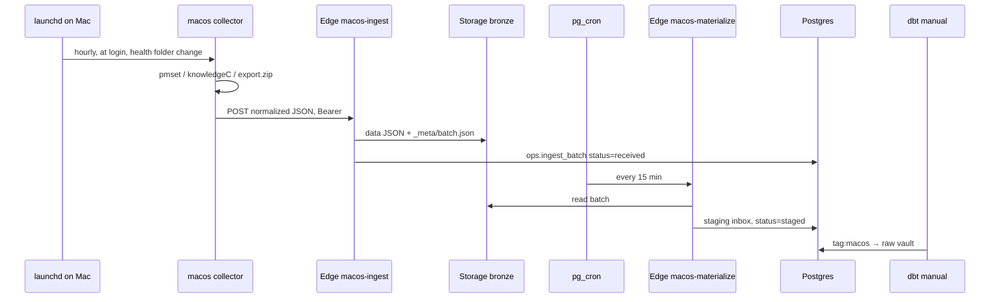

# Mac ローカル ingest 設計（電源・スクリーンタイム・ヘルスケア）

`record_source`: `macos_power` / `macos_screentime` / `apple_health`  
関連: [overview.md](./overview.md), [data-vault-model.md](./data-vault-model.md), [supabase-runtime.md](./supabase-runtime.md), [owntracks.md](./owntracks.md)

Mac 上のデータを、OwnTracks と同じく **Supabase Edge → Storage Bronze → staging inbox → dbt** に載せる。クラウドから Mac を引きに行かない。抽出は Mac の launchd エージェントが行い、正規化済み JSON を push する。

この文書は設計だけを決める。コレクタ、Edge、マイグレーション、dbt モデルは後続の実装ステップである。

## 1. スコープ

| 順 | 内容 |
|----|------|
| **いま作る** | `macos_power` と `macos_screentime`。ops の batch は既存のまま。Raw Vault は `hub_machine` と `hub_os_account` を新設し、`hub_device` は触らない |
| **後** | `apple_health`。センサ識別子も `hub_device` には入れない。入れる hub はそのときに決める |
| **さらに後** | 日次の Business Vault / mart。OwnTracks topic と machine / os account の同一視リンク |

非スコープは [§15](#15-非スコープ)。

## 2. 確定した設計判断

| 項目 | 決定 |
|------|------|
| 抽出場所 | **Mac ローカル**。Edge は受け口だけ |
| 公開経路 | Edge `macos-ingest` 1 本。認証は OwnTracks とは別の Bearer |
| Bronze | 既存規約 `bronze/<record_source>/dt=YYYY-MM-DD/batch=<uuid>/`。中身は正規化 JSON |
| パースの分担 | **正規化は Mac**。materialize は検証・ID 再計算・inbox 投入だけ |
| 関数の数 | ingest 1 + materialize 1。`record_source` と `entity` で振り分ける。ソースごとに関数を複製しない |
| 識別子 | **`hub_device` は OwnTracks の topic 専用のまま**。電源は `hub_machine`（hardware UUID）。スクリーンタイムは `hub_os_account`（そのマシン上の uid）。種類が違うので接頭辞を付けて一つの hub に混ぜない |
| 人物キー | `hub_person` は人そのものなのでソースをまたいで共有する。`default_person_id`。任意で `machines:` / `os_accounts:` |
| ハッシュ | 既存の `hash_key` / `hash_diff` と同じ **md5**。改ざん検知には使わない |
| ヘルスケア原本 | ZIP / XML は Edge に送らない。Mac の archive に残す。Bronze に載るのはレコード JSON |
| 初期の型 | ヘルスケアの Record は allowlist（歩数・心拍・体重・睡眠）。空 allowlist は全 Record 型。Workout と ActivitySummary は最初から対象 |
| dbt | OwnTracks と同様、**手動 workflow**。cron は materialize（15 分）だけ |

## 3. ソースごとの現実

### 3.1 電源（起動・スリープ・停止）

`pmset -g log` が Sleep / Wake / DarkWake / Start の履歴を出す。行にオフセット付き時刻がある。保持は永続ではなく、おおよそ数日〜数週間で落ちる。スリープやシャットダウンの瞬間にはエージェントは動けないので、**次回のログインと 60 分間隔**でログを読み、過ぎたイベントを送る。

`pmset` に `Shutdown` / `Restart` 行が無い Mac がある。Phase 1 は行に書かれた種別だけを事実として保存する。スリープから次の Start までの区間で「電源が落ちていた」と解釈するのは Business Vault の仕事であり、ingest ではやらない。

Unified Log（`Previous shutdown cause`、`Wake reason`、`=== system boot:`）は Phase 2。`log show` は重く、毎時実行に向かない。

### 3.2 スクリーンタイム

公式の書き出し API は無い。Phase 1 はユーザー領域の SQLite だけを読む。

```
~/Library/Application Support/Knowledge/knowledgeC.db
```

`ZOBJECT.ZSTREAMNAME = '/app/usage'` が、最近の macOS でアプリ利用区間に相当する。時刻は Core Data（2001-01-01 起算秒）。Unix にするには `+ 978307200`。`ZOBJECT` はおおよそ数週間でローリングする、という報告がある。**取りこぼし防止に、間隔は 6 時間、重なり窓は 24 時間**とする。

この DB には Safari 履歴や intents も入る。Bronze に載せるのは allowlist したストリームの射影だけである。`SELECT *` や DB ファイルそのものは送らない。

`/var/folders/.../com.apple.ScreenTimeAgent/Store` は TCC で閉じており、使わない。

iPhone のスクリーンタイムは、「デバイス間で共有」がオンで、同じ DB に他デバイス分が混ざる場合だけ拾える。`ZSOURCE` の端末参照は **解釈せず** `source_device_ref` として残す。iPhone 分が必ず揃うとは扱わない。

### 3.3 ヘルスケア.app

Mac のヘルスケアは、iCloud のヘルスケア同期がオンなら iPhone / Apple Watch のサンプルを表示する。センサは Mac とは限らない。

第三者アプリが Mac 上のヘルスケア全履歴を安定して読む API は無い。ディスク上の Health ストアや CloudKit キャッシュは非公開で、パスもスキーマも固定しない。Phase 1 の入力は、ヘルスケア.app の **「すべてのヘルスケアデータを書き出す」** が作る `export.zip`（中身は `export.xml`）だけとする。

書き出しは全量スナップショットで、増分ではない。サンプル数は年単位の歩数だと大きい。Edge のボディサイズと実行時間には載らない。コレクタが XML をストリームしてレコード JSON に分け、チャンクごとに POST する。

ZIP は送信成功後に Mac 上の `archive/health/` へ移す。クラウドに原本 ZIP を置かない。materialize を Edge の外へ出して巨大 XML をパースする経路は、このフェーズでは作らない。

## 4. 論理アーキテクチャ



失敗の分離: 電源・スクリーンタイム・ヘルスケアは別 POST にする。スクリーンタイムが Full Disk Access 不足でも、電源バッチは送る。コレクタの終了コードは、どれか一つでも失敗なら非 0。

## 5. コレクタ

実装時の置き場は `collectors/macos`（TypeScript）。純粋関数（ID、hashdiff、行→イベント）は `packages/ingest-core` に置き、Edge とコレクタと CI で共有する。CI に Mac は不要。`pmset` やファイルコピーはコレクタ側の I/O に閉じる。

### 5.1 スケジュール

| 項目 | 値 |
|------|-----|
| plist | `deploy/macos/launchd/dev.lifelog.macos-collect.plist` |
| 間隔 | 3600 秒、`RunAtLoad` |
| ヘルスケア | ドロップフォルダの `WatchPaths` でも起動 |
| 排他 | ローカル flock。重なっても ID で無害だが、二重 POST は避ける |

状態ディレクトリ（`0700`）:

```
~/Library/Application Support/lifelog/
  config.json          # Edge URL のみ。トークンは置かない
  state.json           # covered_until（電源・スクリーンタイム）
  health_seen.sqlite   # 送信成功した health / workout の ID
  inbox/health/        # ユーザーが export.zip を置く
  archive/health/
  failed/health/
```

Bearer はキーチェーン（service `lifelog-macos-ingest`）。URL だけ `config.json`。

### 5.2 権限

| ソース | 必要なもの |
|--------|------------|
| 電源 | なし（`pmset`） |
| スクリーンタイム | コレクタ実行ファイルへのフルディスクアクセス。DB・WAL・SHM を一時ディレクトリへコピーしてから `sqlite3` で読む |
| ヘルスケア | ドロップフォルダの読み書きだけ。書き出し操作自体はユーザーがヘルスケア.app で行う |

コピーが `EPERM` のときはスクリーンタイムをスキップし、理由をローカルログに残す。権限回復のあと、`covered_until` を戻さなくても重なり窓の外は既に DB から消えていることがある。初回導入時にフルディスクアクセスを先に付ける。

### 5.3 窓

時間で進めるソース（電源・スクリーンタイム）は、成功のたびに `covered_until = exported_at` とし、次回は `covered_until - overlap` 以降を読み直す。

| ソース | overlap |
|--------|---------|
| `macos_power` | 120 分 |
| `macos_screentime` | 24 時間 |

overlap より長い利用区間は、終了時刻の更新を取りこぼし得る。スクリーンタイムの区間は通常もっと短い。ヘルスケアは時刻窓を使わず、コンテンツ ID の seen-set を使う。

seen-set と `covered_until` は **202 を受け取ったあと**に進める。その前に落ちたら同じチャンクを再送する。inbox の一意制約がそれを受ける。

新規イベントが 0 件なら POST しない。

## 6. 受信（Edge `macos-ingest`）

| 項目 | 内容 |
|------|------|
| ルート | `POST /functions/v1/macos-ingest` |
| `verify_jwt` | `false` |
| 認証 | `Authorization: Bearer <MACOS_INGEST_BEARER_TOKEN>`。未設定なら 503 |
| 成功 | `202` と `{ batch_id, bronze_prefix }` |
| 上限 | イベント 1000 件、ボディ 1.5MB。超えたら 413。コレクタが分割する |
| 中身 | 検証に通った JSON をそのまま Bronze へ。ID の再計算は materialize |

トークンは `INGEST_BEARER_TOKEN`（OwnTracks）と分ける。片側のローテーションがもう片側を止めない。

### 6.1 エンベロープ（`schema_version`: 1）

```json
{
  "schema_version": 1,
  "record_source": "macos_power",
  "entity": "power_event",
  "exported_at": "2026-11-08T00:15:00Z",
  "collector": {
    "hardware_uuid": "IOPlatformUUID",
    "os_user_id": 501,
    "hostname": "display only",
    "model": "Mac14,6",
    "os_version": "15.1",
    "timezone": "Asia/Tokyo"
  },
  "extract": {
    "covered_from": "2026-11-07T22:15:00Z",
    "covered_until": "2026-11-08T00:15:00Z",
    "rows_read": 40,
    "rows_emitted": 6
  },
  "events": []
}
```

`record_source` と `entity` の組は次だけを受理する。

| record_source | entity | inbox |
|---------------|--------|-------|
| `macos_power` | `power_event` | `staging.macos_power_event_inbox` |
| `macos_screentime` | `usage_interval` | `staging.macos_screentime_interval_inbox` |
| `apple_health` | `record` | `staging.apple_health_record_inbox` |
| `apple_health` | `workout` | `staging.apple_health_workout_inbox` |
| `apple_health` | `activity_summary` | `staging.apple_health_activity_summary_inbox` |

未知の `schema_version`、未知の組、必須欠落は 400。Bronze には書かない。

`_meta/batch.json` は既存項目に `schema_version` と `entity` を足す。OwnTracks の batch 形は変えない。

### 6.2 materialize

`macos-materialize` を 15 分 cron で起動する。既存の `list_ingest_batches_to_materialize(record_source, 20)` を 3 ソースぶん呼ぶ。1 ソースの失敗が他ソースの列を止めない。

| 結果 | `ops.ingest_batch.status` | 次回 cron |
|------|---------------------------|-----------|
| inbox 投入できた | `staged` | 見ない |
| スキーマ違反・未知 entity | `rejected` + `error_message` | 見ない |
| 想定外の例外 | `error` + `error_message` | 見ない。再実行は status を `received` に戻す |

検証で弾けるものは ingest の 400 に寄せ、`rejected` は Bronze に書いたあとに壊れていた場合の受け皿にする。`received` のままにしない。先頭バッチが永久に列を塞がないようにするためである。

ID と hashdiff は materialize が再計算する。コレクタの seen-set は最適化であり、正は DB の一意制約。

## 7. `macos_power`

### 7.1 抽出

`pmset -g log` の行から、種別トークンが allowlist に入るものだけをイベントにする。

`Sleep`, `Wake`, `DarkWake`, `Start`, `Shutdown`, `Restart`

それ以外（Assertions など）は捨てる。捨てた行も、ファイル全体の読み取りに成功していれば `covered_until` を進めてよい。パーサが途中で落ちた場合は進めない。

### 7.2 イベント

| フィールド | 内容 |
|------------|------|
| `occurred_at` | 行のオフセット付き時刻を timestamptz にしたもの |
| `kind` | allowlist のトークン |
| `message` | 種別より後ろ |
| `raw_line` | 元行 |

ビジネスキー `power_event_id`:

`md5(hardware_uuid || occurred_at || raw_line)`

同一秒の別イベントは `raw_line` で分かれる。`kind` や reason の解釈は sat の属性であり、キーには足さない。

### 7.3 inbox

`staging.macos_power_event_inbox`

| 列 | 内容 |
|----|------|
| `batch_id` | FK `ops.ingest_batch` |
| `power_event_id` | 上記 |
| `machine_bk` | hardware UUID そのもの。接頭辞は付けない |
| `person_id` | person_map の `machines:` または `default_person_id` |
| `occurred_at`, `kind`, `message`, `raw_line` | イベント |
| `payload` | jsonb。エンベロープの collector と当該イベント |
| `hashdiff` | sat に載る記述列 |
| `vault_loaded_at` | dbt が更新。materialize 時点は null |

一意: `(power_event_id, batch_id)`。重なり再送は別バッチとして inbox に残り、sat は hashdiff で増えない。OwnTracks の inbox と同じ考え方。

## 8. `macos_screentime`

### 8.1 抽出

一時コピーに対して、列の存在を `pragma table_info` で確認してから問う。必須列が無ければその回は送らず、ローカルログにスキーマ差を残す。列名の推測で埋めない。

Phase 1 のストリームは `/app/usage` のみ。加えて `ZSTREAMNAME` ごとの件数だけを `extract.stream_counts` に載せる。中身は送らない。スキーマや利用傾向の変化に気づくためで、`/safari/history` の URL は取らない。

区間のビジネスキーに終了時刻を入れない。利用中に end が伸びる更新を、同じ区間の新しい hashdiff として sat に積むためである。

`usage_interval_id`:

`md5(hardware_uuid || os_user_id || stream || bundle_id || started_at || source_device_ref)`

`Z_PK` はコピーや再取込で変わらない保証が無いので使わない。`duration_seconds <= 0` は捨てる。

### 8.2 イベント

| フィールド | 内容 |
|------------|------|
| `stream` | `/app/usage` |
| `bundle_id` | `ZVALUESTRING`。表示名が取れない場合もここはバンドル ID のまま |
| `started_at`, `ended_at` | UTC |
| `duration_seconds` | end − start |
| `source_device_ref` | `ZSOURCE` 側の端末識別。無ければ空文字 |

### 8.3 inbox

`staging.macos_screentime_interval_inbox`

`os_account_bk` は `<hardware_uuid>:<uid>`。電源の `machine_bk` とは別の hub に入る。スクリーンタイムは OS ユーザーの DB であり、スリープはマシン単位だからである。`source_device_ref` は列として残すが hub にはしない。

一意: `(usage_interval_id, batch_id)`。他列は `hardware_uuid`, `uid`, `person_id`, `bundle_id`, `started_at`, `ended_at`, `duration_seconds`, `source_device_ref`, `payload`, `hashdiff`, `vault_loaded_at`。

## 9. `apple_health`

### 9.1 入力とハードスキップ

ドロップフォルダの `export.zip` をストリーム解析する。次は allowlist に関係なく捨てる。

| 捨てるもの | 理由 |
|------------|------|
| `Me`（生年月日、性別、血液型などの特性） | サンプル系列と別の、より機微な属性 |
| `ClinicalRecord` | 診療情報。この設計の対象外 |
| `Correlation` | 血圧などは Phase 2。子要素の分解を Phase 1 に入れない |
| `WorkoutRoute` と位置の `MetadataEntry` | 軌跡は OwnTracks に任せ、大きな位置列をヘルスケア経路で持たない |

`WorkoutStatistics` はワークアウトの要約なので残す。

### 9.2 Record の allowlist

`config/sources.yml` の `hk_types`。初期値:

| HK 型 | 短いコード（mart / BV 用） |
|-------|---------------------------|
| `HKQuantityTypeIdentifierStepCount` | `steps` |
| `HKQuantityTypeIdentifierHeartRate` | `heart_rate` |
| `HKQuantityTypeIdentifierBodyMass` | `weight` |
| `HKCategoryTypeIdentifierSleepAnalysis` | `sleep_analysis` |

`hk_types` を空配列にしたときだけ、ハードスキップ以外の全 `Record` を送る。hub のビジネスキーは短いコードではなく **HK 型文字列**とする。短いコードはマップできなかった型では null でよい。マップは `config/apple_health_types.yml` に置き、dbt が読む。

睡眠はサンプルのまま保存する（`InBed` / `Awake` / `AsleepUnspecified` / `AsleepCore` / `AsleepDeep` / `AsleepREM`）。セッションへの結合は `bv_sleep_session`（Phase 4）。

### 9.3 ID

Record は不変サンプルとして扱う。`creationDate` と `sourceVersion` は再同期で変わり得るのでキーに入れない。`device` 属性は記録時の機器情報としてキーに含める。

`health_record_id = md5(hk_type || source_name || device || unit || start_date || end_date || value)`

日付は XML の原文を使う。パースし直したタイムスタンプだけをキーにすると、オフセットの正規化差で重複する。

Workout も不変とする。

`workout_id = md5(activity_type || source_name || device || start_date || end_date || duration || duration_unit || total_distance || total_energy)`

ActivitySummary は同じ日の値が更新される。

`activity_summary_id = md5(collector hardware_uuid || os_user_id || date_components)`

値は hashdiff 側に置く。

### 9.4 チャンクと一意制約

| 項目 | 決定 |
|------|------|
| 単位 | entity ごとに別 POST。1 バッチに record と workout を混ぜない |
| サイズ | 500 件、または 1MB 未満。先に達した方で切る |
| record / workout | `unique (id)`。`ON CONFLICT DO NOTHING`。`batch_id` は初回に見たバッチ |
| activity_summary | `unique (activity_summary_id)`。hashdiff が変わったときだけ payload・hashdiff・`batch_id` を更新し、`vault_loaded_at` を null に戻す。dbt が新しい sat 行を足すため |

全量書き出しを `(id, batch_id)` で受けると、inbox が書き出しの回数だけ膨れる。スナップショット源だけ一意を ID 全体にする。電源・スクリーンタイム・OwnTracks は従来どおり `(id, batch_id)`。

センサの識別子は `hub_device` に入れない。ヘルスケアを実装するとき、記録元（`sourceName` と `device` 属性）をどの hub にするかを別に決める。コレクタ Mac との関係は `hub_machine` / `hub_os_account` への link で表す。

### 9.5 inbox の主な列

`staging.apple_health_record_inbox`: `health_record_id`, `person_id`, `sensor_device_bk`, `collected_by_device_bk`, `hk_type`, `observation_code`, `value_numeric`, `value_text`, `unit`, `started_at`, `ended_at`, `source_name`, `payload`, `hashdiff`, `vault_loaded_at`

`value_numeric` は数値にできるときだけ。カテゴリ値（睡眠）は `value_text`。両方 payload に原文を残す。

`staging.apple_health_workout_inbox`: `workout_id`, `person_id`, `sensor_device_bk`, `activity_type`, `started_at`, `ended_at`, `duration_seconds`, `total_distance_m`, `total_energy_kcal`, `payload`, `hashdiff`, `vault_loaded_at`

単位が変換できない値は payload に残し、正規化列は null。黙って 0 にしない。

`staging.apple_health_activity_summary_inbox`: `activity_summary_id`, `person_id`, `collected_by_device_bk`, `summary_date`, `active_energy_kcal`, `exercise_minutes`, `stand_hours`, 各 goal 列, `payload`, `hashdiff`, `vault_loaded_at`

どの inbox も RLS を有効にし、`anon` / `authenticated` からは剥がす。OwnTracks inbox と同じである。

## 10. ops と Raw Vault

### 10.1 共有してよいもの

`ops.ingest_batch` はビジネス上の「デバイス」ではない。1 回の POST の受付記録で、ソースが違ってもグレインは同じである。電源もスクリーンタイムも新しい ops テーブルは作らず、`record_source` が `macos_power` または `macos_screentime` の行を足す。

| 列 | いま |
|----|-----|
| `batch_id`, `record_source`, `bronze_prefix` | そのままで足りる |
| `status` | `received` → `staged`。壊れたバッチは `rejected` または `error`（[§6.2](#62-materialize)） |
| `started_at`, `finished_at`, `error_message` | そのまま |

`ops.dbt_run_log` も変えない。

`hub_person` も共有する。BK は `person_id` で、OwnTracks も Mac も「誰のライフログか」を指す。これは識別子の種類が同じだからである。所属は `person_map` の宣言であり、topic と hardware UUID が同一だという意味ではない。

landing は Raw Vault の外、既存と同じく staging inbox である。

| inbox | 粒 |
|-------|----|
| `staging.macos_power_event_inbox` | 電源イベント 1 行 |
| `staging.macos_screentime_interval_inbox` | `/app/usage` 区間 1 行 |

### 10.2 `hub_device` には入れない

今の `hub_device.device_bk` は OwnTracks の **topic 全文**（`owntracks/me/iphone`）である。`device_hk` は `md5(topic)` で、`link_person_device` も `(person_id, topic)` で結んでいる。これはアプリに設定した配信先の名前であり、ハードウェア番号でも OS アカウントでもない。

電源・スクリーンタイム側にあるのは別種の識別子である。

| 識別子 | 何か | 例 | このラウンドの hub |
|--------|------|----|--------------------|
| OwnTracks topic | アプリに付けた配信名。人が書き換えられる | `owntracks/me/iphone` | 既存 `hub_device`。変えない |
| hardware UUID | マシン。スリープと起動の主体 | `IOPlatformUUID` | **`hub_machine`**。BK は UUID そのもの |
| uid | そのマシン上の macOS アカウント。`knowledgeC.db` の主体 | `501` | **`hub_os_account`**。BK は `<hardware_uuid>:<uid>` |
| `ZSOURCE` の端末参照 | 未解釈の文字列。iPhone かもしれないし、そうでないかもしれない | 空、または DB 依存の ID | hub にしない。区間 sat の属性 |

接頭辞 `macos:` を付けて `hub_device` に足すと、衝突は避けられるが、`device_hk` の意味が「topic のハッシュ」ではなくなる。あとから「この topic はこの Mac だ」と分かっても、1 行に潰せず、別リンクが必要になる。最初から分けておく。

同一視は、根拠ができたときだけの link とする（このラウンドでは作らない）。

```
link_device_machine       OwnTracks topic × hub_machine
```

この link を OwnTracks アプリからの受信で埋めることはできない。位置 JSON に hardware UUID が無く、iOS からは `IOPlatformUUID` を読めない。`_type=status` の `deviceIdentifierForVendor` は別種の ID なので `hub_machine` に入れない。詳細は [owntracks.md](./owntracks.md) の「ハードウェア UUID は載らない」。

iPhone の topic と、スクリーンタイムの `source_device_ref` は、両方の実体が分かるまで結ばない。topic と Mac の関係は、いまは `hub_person` を共有していることだけである。

### 10.3 このラウンドの Raw Vault

```
hub_person            BK: person_id                 既存。共有
hub_device            BK: OwnTracks topic           既存。電源・スクリーンタイムからは行を足さない
hub_machine           BK: hardware_uuid
hub_os_account        BK: <hardware_uuid>:<uid>
hub_application       BK: bundle_id
hub_power_event       BK: power_event_id
hub_usage_interval    BK: usage_interval_id

link_person_machine
link_person_os_account
link_machine_os_account
link_machine_power_event
link_os_account_usage_interval
link_usage_interval_application

sat_macos_power_event            kind, message, raw_line, occurred_at
sat_macos_screentime_interval    ended_at, duration, source_device_ref を hashdiff に含める
```

`hub_machine` の表示名（hostname, model, os_version）は、変わっても BK ではない。必要になったら `sat_machine_details` を足す。Phase 1 の電源 sat はイベント側だけでよい。

sat は insert-only。同一 BK で hashdiff が同じ行は足さない。必須メタデータは `load_dts`, `record_source`, `batch_id`。dbt の `hash_key` / `hash_diff` を使う。

ヘルスケア用の `hub_health_record` や `hub_workout` は、ヘルスケアを実装するときにこの節へ足す。センサ名を `hub_device` に流し込まない、という制約だけ先に固定する。

## 11. Business Vault / Mart（Phase 4）

| オブジェクト | 内容 |
|--------------|------|
| `bv_power_interval` | Sleep または Shutdown と、次の Wake または Start の組。理由の解釈はここに書く |
| `bv_screentime_daily` | 日 × device × bundle の秒数 |
| `bv_observation_daily` | 歩数・心拍・体重の日次 |
| `bv_sleep_session` | 連続する睡眠カテゴリの結合 |
| `mart_machine_power_daily` | マシンごとのスリープ回数、起動回数 |
| `mart_pc_activity_daily` | スクリーンタイム日次。ActivityWatch を足すときもこの mart |
| `mart_health_daily` | マップ済み observation の日次 |

Phase 1〜3 は inbox と sat までで止めてよい。mart の器は [data-vault-model.md](./data-vault-model.md) に既にある。

## 12. セキュリティ

- Bronze バケットは private のまま。パイプライン schema は API に出さない。inbox は RLS。
- ログにイベント本文、バンドル ID の列、ヘルスケアの値を出さない。
- スクリーンタイムは allowlist ストリームだけ。`stream_counts` は名前と件数だけ。
- ヘルスケアの `Me` と `ClinicalRecord` は送らない。
- ワークアウトの経路（GPS）は送らない。
- Bearer はキーチェーン。`config.json` と plist に書かない。
- コレクタは個人の Mac 1 台・主要 OS ユーザー 1 人を前提にする。二人目のユーザーが同じエージェントを動かすと、スクリーンタイムは別の `hub_os_account` になる。電源はマシン単位なので、エージェントは一人のユーザーだけに入れる。

## 13. 運用

| 項目 | 方針 |
|------|------|
| コレクタ | ログイン時 + 60 分。ヘルスケアは ZIP を置いたときも |
| materialize | 15 分。`config/sources.yml` の `materialize_interval_minutes` |
| dbt | `dbt build --select tag:macos`。workflow は `workflow_dispatch` のみ |
| タグ | 各モデルに `macos` と、`macos_power` / `macos_screentime` / `apple_health` |
| 障害 | `rejected` と `error` は cron の対象外。`error_message` を見て直す |
| 欠測 | 電源もスクリーンタイムもソース側の保持が短い。エージェントを止めると穴が埋まる保証は無い |

`sources.yml` の初期値はすべて `enabled: false`。実装が終わるまでコレクタは送らない。

## 14. リポジトリ配置（実装時）

```
collectors/macos/                         # launchd から動かす I/O
packages/ingest-core/src/macos/           # 純粋関数: id, hashdiff, allowlist
packages/ingest-core/test/fixtures/macos/ # pmset 行、usage 行、Record 断片
supabase/functions/macos-ingest/
supabase/functions/macos-materialize/
config/apple_health_types.yml
config/sources.yml                        # 既定値。enabled は false のまま始める
config/person_map.yml                     # 任意の machines: / os_accounts:
deploy/macos/launchd/
packages/dbt/models/...                   # tag:macos
```

ローカルの Hono（`packages/ingest`）に同等の `POST /ingest/macos` を足すかは実装時でよい。本番の正は Edge である。

## 15. 非スコープ

- iPhone 単体でのスクリーンタイム読み取り、Screen Time の公式エクスポート（存在しない）
- `knowledgeC.db` の `/app/webUsage` と `/safari/history`。入れるなら別途 allowlist を広げる変更として扱う
- ActivityWatch。PC 利用の別ソースとして `sources.yml` に残す。スクリーンタイムの代替にはしない
- Health Auto Export など iOS アプリの Webhook。Mac のヘルスケア.app とは別ソース
- ヘルスケア特性（`Me`）、診療記録、血圧 Correlation、ワークアウト経路
- Unified Log のシャットダウン理由（Phase 2 の電源の拡張）
- 原本 ZIP のクラウド保管
- この設計の実装そのもの（コレクタ、マイグレーション、Edge、dbt）

## 16. 実装ステップ

1. **電源の純粋関数と fixture**。`pmset` 行 → イベント。CI だけで完結させる。
2. **inbox マイグレーション + `macos-ingest` + `macos-materialize`**。電源だけ通す。
3. **コレクタの電源と launchd**。実機で 1 日分が inbox に入ることを確認する。
4. **スクリーンタイム**。フルディスクアクセスが無いときのスキップを先に確認する。
5. **ヘルスケア**。小さな `export.zip` fixture でスキップ対象が Bronze に無いこと、allowlist の 4 型と workout と activity summary が入ることを確認する。それから実書き出し。
6. **dbt**。sat の hashdiff テストのあと、日次 BV と mart。

各ステップは、前のソースが止まってもデプロイできる単位で切る。
