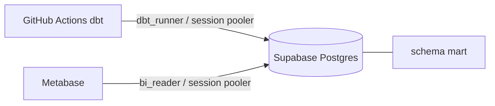

# Metabase（BI）

関連: [supabase-runtime.md](./supabase-runtime.md), [overview.md](./overview.md), [owntracks.md](./owntracks.md)

手順: [../operations/metabase-setup.md](../operations/metabase-setup.md)

---

## 1. 目的

`mart` をダッシュボードで見る。最初の対象は `mart.mart_location_trail`（`tst` / `lat` / `lon`）。位置情報なので、Data API には出さず、Metabase のログインの向こうに置く。

## 2. 配置

Metabase は Supabase の外のプロセス。Supabase に載せるのはログインロール `bi_reader` と、そのパスワード用の Vault だけ。

| もの | 置き場 |
|------|--------|
| 質問・ダッシュボード（Metabase アプリ DB） | ローカルは Compose の H2 ボリューム。常時起動するときは **Vault とは別の Postgres** |
| 集計対象 | Supabase Postgres のスキーマ `mart` |
| 起動（手元） | [`deploy/docker/docker-compose.metabase.yml`](../../deploy/docker/docker-compose.metabase.yml)（`make metabase-up`） |
| イメージ | `metabase/metabase:v0.64.4`（64 LTS。サポート期限 2027-12-01。`latest` は使わない） |

アプリ DB を Vault と同じインスタンスに置かない。`supabase db reset` や容量制限と、ダッシュボード定義の寿命を分ける。

常時公開するときは、同じ `bi_reader` 接続のままコンテナを VM に移し、アプリ DB だけ別 Postgres（`MB_DB_TYPE=postgres`）にする。Metabase Cloud でも倉庫の接続先はこのドキュメントのまま。

## 3. 権限

ロール `bi_reader`（migration `20261107143000_bi_reader_role.sql`）。

| 項目 | 内容 |
|------|------|
| 属性 | `LOGIN`、`NOSUPERUSER`、`NOBYPASSRLS`、`NOINHERIT`、`CONNECTION LIMIT 10` |
| スキーマ | `mart` の `USAGE` のみ。`staging` / `raw_vault` / `business_vault` / `ops` は revoke |
| テーブル / view | `mart` の `SELECT` のみ |
| `search_path` | `mart` |
| タイムアウト | `statement_timeout` 60s、`lock_timeout` 5s、`idle_in_transaction_session_timeout` 60s（セッションから変更はできる。Metabase の通常クエリはロール既定のまま） |
| Data API | `anon` / `authenticated` / `authenticator` にメンバーシップを付けない。`config.toml` の `[api] schemas` にも `mart` を入れない |

`mart.mart_location_trail` は `raw_vault` を参照する view。Postgres の既定は `security_invoker = false` で、中身は **view 所有者**の権限で実行される。dbt の post-hook（[`grant_mart_to_bi_reader`](../../packages/dbt/macros/grant_mart_to_bi_reader.sql)）が view に `security_invoker = false` を明示し、`bi_reader` に `SELECT` を付ける。本番の dbt は `dbt_runner` で走るので、所有者は `dbt_runner`。`bi_reader` の SQL から `raw_vault` を直接は読めない。

`dbt_runner` が後から作るオブジェクトへの default privileges は、migration が張れるときだけ張る。ホストされた Supabase の `postgres` が権限不足のときは notice にして止めない。その場合も post-hook が `GRANT` する。`postgres` が作る `mart` オブジェクトには default privileges で `SELECT` を付ける。

`bi_reader` ロールが無い DB（レガシー Compose Postgres）では post-hook は何もしない。

将来 `mart` を **テーブル**にするときは RLS を有効にし、`bi_reader` 向けの `SELECT` policy を付ける。ポリシーなしの RLS は 0 行になる。view には RLS を張らない。

## 4. パスワード

`dbt_runner` と同じ形。

| 環境 | 流れ |
|------|------|
| ローカル | `make supabase-reset` の [`supabase/seed.sql`](../../supabase/seed.sql) が Vault `bi_reader_password` = `local-bi-reader` を入れ、`ops.sync_bi_reader_password_from_vault()` でロールに反映する。seed は本番 `db push` では走らない |
| 本番 | Dashboard → Vault に `bi_reader_password` を作る。次の deploy が sync する。任意で deploy 実行時の環境変数 `BI_READER_PASSWORD` が Vault を upsert する |

関数は `security definer`、`search_path` を固定し、`public` / `anon` / `authenticated` / `bi_reader` から `EXECUTE` を外す。

## 5. 接続

Metabase は prepared statement を使う。入り口は **Session pooler のポート 5432**。Transaction pooler（6543）は使わない。

| | ローカル（コンテナから） | 本番 |
|--|--------------------------|------|
| Host | `host.docker.internal` | Session pooler ホスト（dbt と同じ解決） |
| Port | `54422` | `5432` |
| Database | `postgres` | `postgres` |
| User | `bi_reader` | `bi_reader.<project-ref>` |
| Password | `local-bi-reader` | Vault の値 |
| SSL | オフ | require |
| スキーマ | `mart` だけ同期 | 同じ |
| 接続プール | 3 | 3（ロール上限は 10。Compose は `MB_JDBC_DATA_WAREHOUSE_MAX_CONNECTION_POOL_SIZE=3`） |

手元の Metabase に本番を足すコマンドは `make metabase-connect-remote`。接続先は dbt と同じ Session pooler で、ユーザーは `bi_reader.<project-ref>`。コンテナから届けるホスト名も、その pooler の公開名。手順は [metabase-setup.md](../operations/metabase-setup.md) の本番節。

表示タイムゾーンは Compose の `JAVA_TIMEZONE=Asia/Tokyo`。`tst` は `timestamptz` なので、ダッシュボード上の日付は日本時間になる。

## 6. 最初のダッシュボード

`mart.mart_location_trail` の 2 枚。

1. ピン地図。`lat` / `lon` を緯度・経度にする（Metabase が自動判定しないときは Table Metadata）。
2. 日次の件数。`tst` を `Asia/Tokyo` の日で切る。

SQL は [セットアップ手順](../operations/metabase-setup.md) に書く。質問定義はアプリ DB にあり、リポジトリには置かない。

## 7. 公開

手元の Compose は `127.0.0.1` にだけポートを出す。常時起動で URL を開けるようにする場合も、Metabase のログインを必須にし、地図の public link は作らない。

## 8. リポジトリ対応

| ファイル | 役割 |
|----------|------|
| `supabase/migrations/20261107143000_bi_reader_role.sql` | ロール、GRANT、sync 関数 |
| `supabase/seed.sql` | ローカルパスワード |
| `scripts/deploy.ts` | 本番 Vault upsert（任意）と sync |
| `packages/dbt/macros/grant_mart_to_bi_reader.sql` | mart モデルの `SELECT` |
| `packages/dbt/dbt_project.yml` | marts の post-hook |
| `deploy/docker/docker-compose.metabase.yml` | ローカル Metabase（ヒープ 2GB。起動前に残った Liquibase ロックを外す） |
| `scripts/metabase-add-remote.ts` | 本番 `mart` を Metabase に登録 |
| `Makefile` | `metabase-up` / `metabase-down` / `metabase-logs` / `metabase-connect-remote` |
