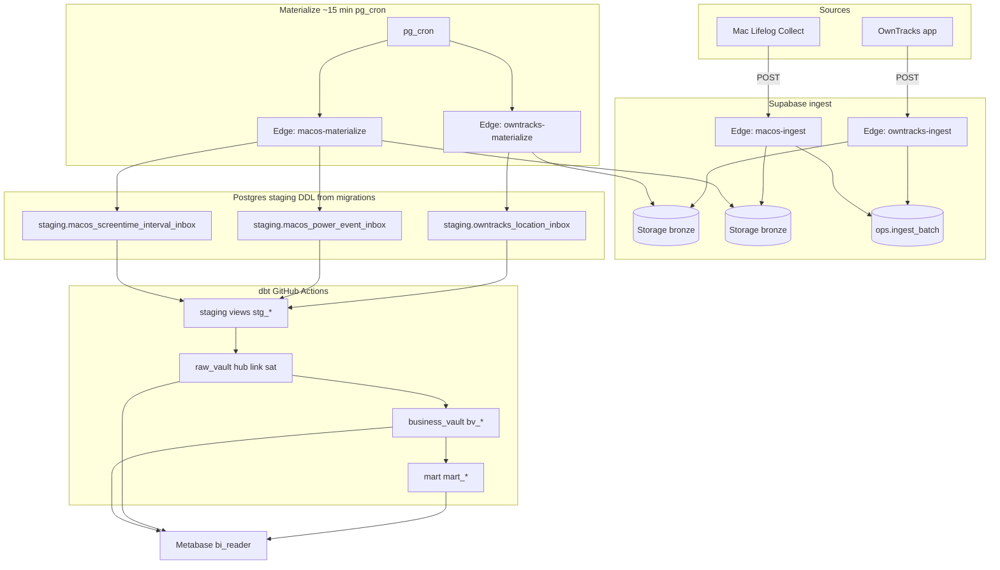
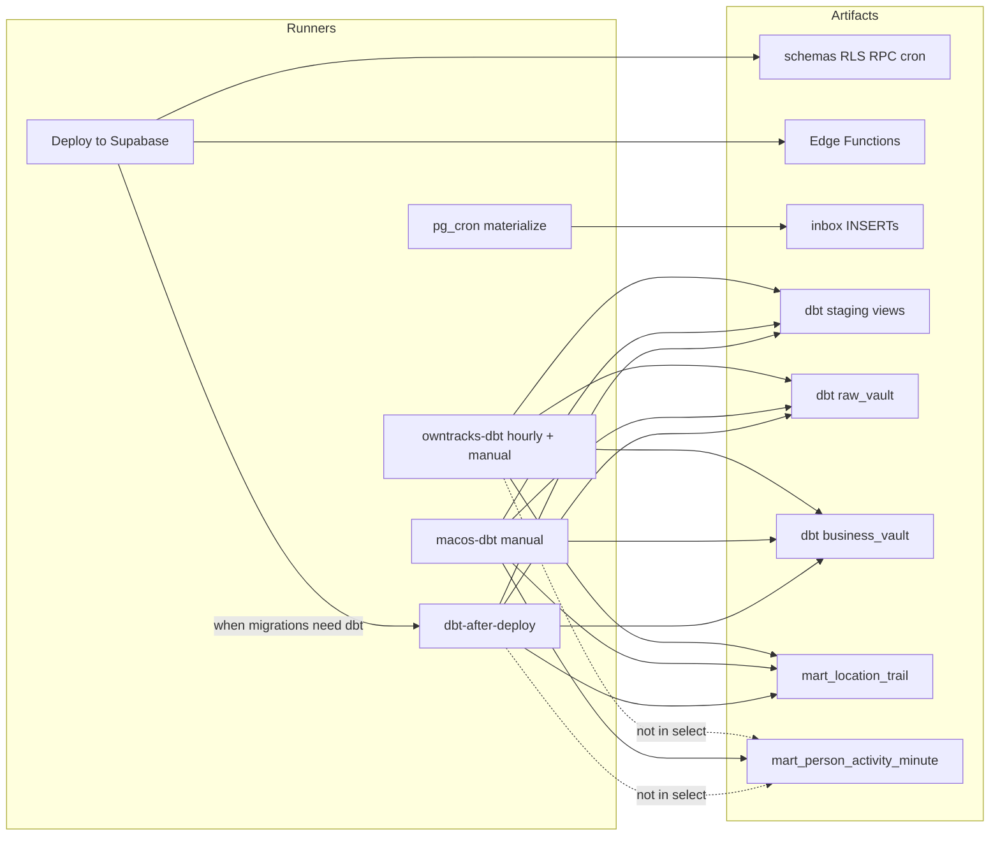
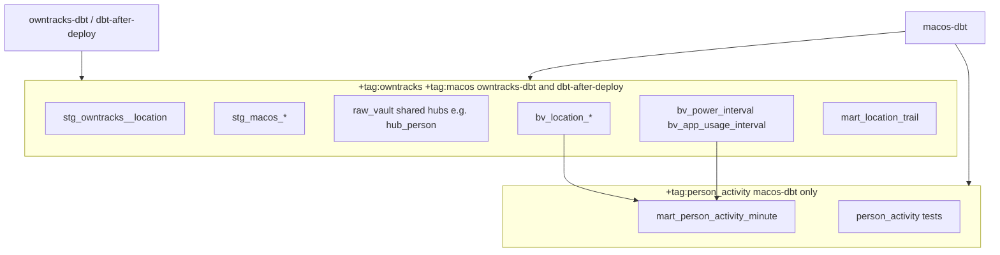
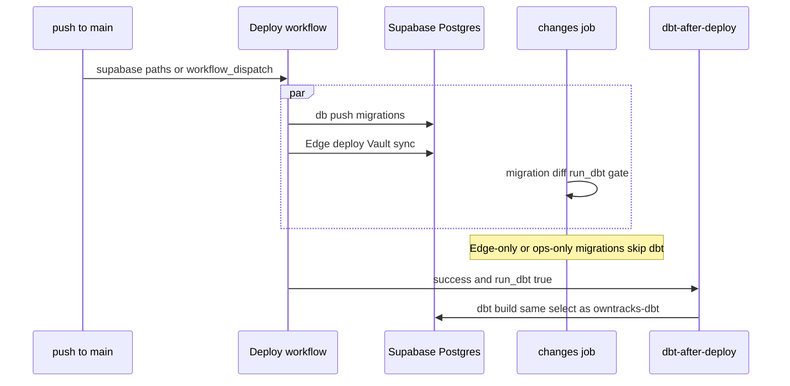

# Monorepo overview design

See GitHub issue #4 for the canonical design discussion snapshot.

Source-specific designs: [owntracks.md](./owntracks.md) (location / H3), [macos-local-ingest.md](./macos-local-ingest.md) (Mac power, Screen Time, Health). Where a person was and what they were doing at a time: [person-activity.md](./person-activity.md).

**Production runtime (dbt 以外):** [supabase-runtime.md](./supabase-runtime.md) — Postgres, Edge ingest/materialize, Storage Bronze.

## Purpose

Ingest personal lifelog data (health, PC activity, manual metrics), store immutable Bronze (Supabase Storage), model **Data Vault 2.0** in **Supabase Postgres**, expose marts for BI. **dbt** runs outside Supabase (e.g. GitHub Actions).

## Principles

1. Layer boundaries match directories (ingest / staging / raw_vault / business_vault / mart).
2. New sources add ingest module + dbt staging + satellites (hubs stable).
3. Every load is traceable via `batch_id`, `record_source`, `load_dts`.
4. Secrets never committed; Supabase Edge Secrets + GitHub Secrets for dbt.
5. Local dev via `supabase start`; dbt uses pooler URL from `.env` (not committed).
6. Vault DDL in SQL migrations; dbt owns transforms into existing tables.

## Logical architecture

```
Sources → Edge ingest → Storage Bronze + ops.ingest_batch
Cron → Edge materialize → staging inbox
GitHub Actions → dbt → raw_vault → business_vault → mart
Metabase (bi_reader, session pooler) → mart, business_vault, raw_vault
GitHub → CI (ingest typecheck, dbt parse)
```

Detail for **production Supabase + GitHub Actions dbt** is below. Ingest/materialize runtime: [supabase-runtime.md](./supabase-runtime.md). dbt triggers and secrets: [../operations/dbt-ci-setup.md](../operations/dbt-ci-setup.md).

### End-to-end data flow

Bronze and inbox rows are written by **Edge + pg_cron**. Vault and marts are built only by **dbt** (session pooler, `dbt_runner`). Deploy `db push` applies DDL, RPCs, and cron definitions; it does not run transforms.



### Jobs and what they build



Dashed arrows: `mart_person_activity_minute` has tag `person_activity` only; **owntracks-dbt** and **dbt-after-deploy** use `dbt build --select +tag:owntracks +tag:macos` and therefore do not build that mart. **macos-dbt** adds `+tag:person_activity` (Mac-side shortcut that still pulls location BV upstream via `+`). See [person-activity.md](./person-activity.md).

### dbt workflow vs model tags



The `+` prefix includes **parents** of tagged models, not children. BV models carry both source tags (`owntracks`, `macos`) and `person_activity`; hourly build refreshes BV tables but not the minute mart unless `person_activity` is in the select.

### Deploy and dbt-after-deploy



All remote dbt jobs share [`.github/workflows/dbt-build-remote.yml`](../../.github/workflows/dbt-build-remote.yml) and concurrency group `owntracks-dbt` so hourly, post-deploy, and manual runs do not overlap.

| Job | Trigger | Writes data? | dbt layers built |
|-----|---------|--------------|------------------|
| **materialize** | pg_cron ~15m | inbox from bronze | — |
| **owntracks-dbt** | hourly UTC + manual | — | staging, raw_vault, BV, `mart_location_trail` |
| **macos-dbt** | manual | — | above + `mart_person_activity_minute` |
| **Deploy** | main push paths / manual | DDL, Edge | — |
| **dbt-after-deploy** | after Deploy when gated | — | same as owntracks-dbt |

## Repository layout

```
packages/ingest/         TypeScript ingest (Hono webhook, materialize → Bronze)
packages/dbt/            dbt project lifelog_vault
deploy/docker/           local Postgres; Metabase compose (see metabase.md)
deploy/sql/migrations/   Hub/Link/Sat DDL
deploy/oci/systemd/      timers (future)
.github/workflows/       CI
docs/                    architecture, runbooks, ADR
```

## Bronze path convention

```
bronze/<record_source>/dt=YYYY-MM-DD/batch=<uuid>/
  data/...
  _meta/batch.json
```

## PostgreSQL schemas

| Schema | Role |
|--------|------|
| staging | dbt staging models |
| raw_vault | hub_*, link_*, sat_* (Metabase via `bi_reader`, [metabase.md](./metabase.md)) |
| business_vault | bv_* (Metabase via `bi_reader`, [metabase.md](./metabase.md)) |
| mart | mart_* (Metabase via `bi_reader`, [metabase.md](./metabase.md)) |
| ops | ingest_batch, dbt_run_log |

## dbt naming

- `stg_<source>__<entity>`
- `hub_*`, `link_*`, `sat_*`, `bv_*`, `mart_*`

## Production orchestration (OCI)

1. `lifelog-ingest run-all`
2. `dbt run` / `dbt test` with batch vars
3. Log to `ops`

## Phases

| Phase | Deliverable |
|-------|-------------|
| 0 | Skeleton, compose, migrations shell, dbt parse CI |
| 1 | One source end-to-end to mart |
| 2 | ops.ingest_batch, backfill runbook, second source |
| 3 | Business Vault rules, Metabase ([metabase.md](./metabase.md): `bi_reader` + local compose), backup to R2 |
| 4 | Terraform OCI, PIT/Bridge |
