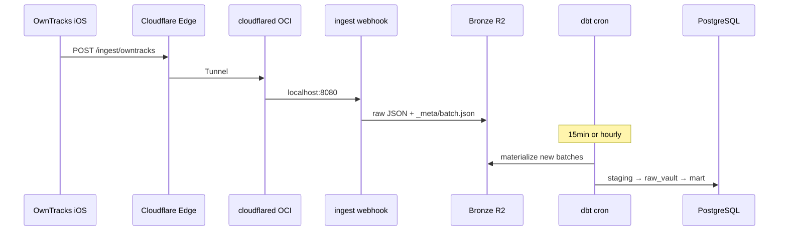

# OwnTracks 位置情報 ingest 設計

`record_source`: `owntracks`  
関連: [overview.md](./overview.md), [data-vault-model.md](./data-vault-model.md), Issue #4（モノレポ概要）

## 1. スコープ

| Phase | 内容 |
|-------|------|
| **1** | HTTP `_type=location` → Bronze → Staging → Raw Vault（H3 含む）→ 簡易 Mart |
| **1.5** | `_type=transition`（ジオフェンス） |
| **2** | Business Vault（Google Maps 等との統合）、Recorder 連携（任意） |

非スコープ（初期）: MQTT 自前ブローカー、暗号化ペイロードの復号、`_type=card` / `waypoint`。

## 2. 確定した設計判断

| 項目 | 決定 |
|------|------|
| 公開経路 | **Cloudflare Tunnel**（OCI 上は Webhook のみ `127.0.0.1`、443 は開けない） |
| 空間キー | **最初から H3**（resolution 9）を `hub_location_h3` のビジネスキー |
| 端末キー | **`topic` 全文**を `hub_device` の BK（例: `owntracks/me/iphone`） |
| 人物キー | **`config/person_map.yml` の `person_id`**（個人は `me` 等 1 行で開始） |

`tid` は HTTP モードで必須だが **Hub キーにしない**（表示・Sat 属性として保持。端末識別は `topic` が安定）。

## 3. OwnTracks アプリ前提

- [HTTP モード](https://owntracks.org/booklet/tech/http/): MQTT と同一 JSON を POST
- 位置ペイロード: `_type=location`, `lat`, `lon`, `tst` 必須; HTTP では `tid` 必須
- ペイロード内 `topic`（例 `owntracks/<user>/<device>`）を device BK に使用

## 4. 論理アーキテクチャ



## 5. 受信（ingest webhook）

### 5.1 責務

1. **認証**: `Authorization: Bearer <secret>`（または `X-Ingest-Token`）
2. **受理**: 検証成功後すぐ 2xx（R2 書き込み失敗時は 5xx で OwnTracks / 中継の再試行に任せる）
3. **Bronze**: 1 POST = 1 `batch_id`、生 JSON は改変しない

### 5.2 Bronze パス

```
bronze/owntracks/dt=YYYY-MM-DD/batch=<uuid>/
  data/{received_at}_{request_id}.json
  _meta/batch.json
```

`_meta/batch.json`: `batch_id`, `record_source`, `ingested_at`, `schema_version`

### 5.3 デプロイ（OCI）

| コンポーネント | 役割 |
|----------------|------|
| `lifelog-ingest serve owntracks` | FastAPI、`:8080` bind localhost |
| `cloudflared` | Tunnel → 公開ホスト名（例 `ingest.example.com`） |
| systemd | webhook + cloudflared 常駐 |

Secrets（リポジトリ外）: `INGEST_BEARER_TOKEN`, R2 資格情報, Tunnel token。

## 6. Bronze → Staging

**方針**: Webhook は R2 のみ。`lifelog-ingest materialize-owntracks` が新規 batch を読み、`staging.owntracks_location_inbox` に 1 行ずつ投入（または Parquet 中間を Phase 2 で検討）。

### 6.1 `stg_owntracks__location`（dbt）

| 列 | 由来 |
|----|------|
| `location_event_id` | `md5(topic \|\| tst \|\| lat \|\| lon \|\| coalesce(t,''))` |
| `topic` | payload |
| `person_id` | `person_map` から（topic の user セグメントまたは default） |
| `tid`, `tst`, `lat`, `lon` | payload |
| `h3_index_r9` | lat/lon → H3 res 9（materialize または dbt 前処理） |
| `trigger_code` | `t` |
| `accuracy_m`, `altitude_m`, `velocity_kmh`, `battery_pct` | `acc`, `alt`, `vel`, `batt` |
| `in_regions`, `motion_activities` | jsonb |
| `load_dts`, `batch_id`, `record_source` | パイプライン |

## 7. Raw Vault（OwnTracks / location）

```
hub_person              BK: person_id (config)
hub_device              BK: topic
hub_location_h3         BK: h3_index_r9
hub_location_event      BK: location_event_id   # 点イベント（fix）

link_person_device
link_device_location_event      device × location_event
link_location_event_h3_cell     location_event × h3_cell

sat_owntracks_location          属性 + hashdiff（insert-only）
```

- 同一 `location_event_id` で属性変更 → 新 Sat 行; **同一 hashdiff** はロードしない
- Google Maps 統合時は別途 `hub_location_place`（Place ID）を BV で H3 と突合（Phase 2）

## 8. Business Vault / Mart（最小）

| オブジェクト | 内容 |
|--------------|------|
| `bv_location_fix` | owntracks の fix 時系列 |
| `mart_location_trail` | BI: tst, lat, lon, h3, trigger |
| `mart_location_daily` | 日 × device: fix 数、H3 セル集合、粗い移動距離 |

## 9. セキュリティ

- 位置情報は機微: R2 バケット非公開、ログに lat/lon を出さない
- Webhook: TLS（Tunnel 終端）+ Bearer 必須
- Postgres は localhost のみ

## 10. 運用

| 項目 | 方針 |
|------|------|
| Webhook | 常時 |
| materialize + dbt | 15 分〜1 時間 cron、`dbt run --select tag:owntracks` |
| `ops.ingest_batch` | received → staged → vault_loaded |
| アラート | 24h fix 0 件 → Tunnel / アプリ / 証明書確認 |

## 11. リポジトリ配置（実装時）

```
packages/ingest/src/              # TypeScript (@lifelog/ingest)
  server.ts                       # Hono POST /ingest/owntracks
  owntracks/materialize.ts
  bronze/, db.ts, owntracks/parse.ts
packages/dbt/models/staging/stg_owntracks__location.sql
packages/dbt/models/raw_vault/...   # hub/link/sat
config/sources.yml                  # owntracks.enabled
config/person_map.yml
deploy/oci/systemd/                 # lifelog-owntracks-web, cloudflared
```

## 12. 実装ステップ

1. **1a** ローカル Webhook + R2/MinIO、curl で Bronze
2. **1b** OwnTracks 実機 → Tunnel → 本番 Bronze
3. **2** materialize + dbt（H3 Hub 含む Raw Vault）
4. **3** dbt tests + `mart_location_trail`
5. **4** transition / region Hub

実装トラッキング: GitHub Issue「Phase 1: OwnTracks ingest」（本リポジトリで別 Issue）。
