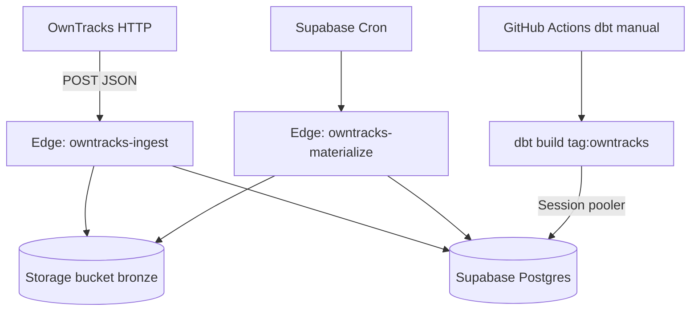

# Supabase ランタイム設計（dbt 以外）

**前提:** Data Vault の **変換層（dbt）だけ Supabase 外**で実行する。それ以外（Postgres、ingest Webhook、Bronze、materialize、バッチメタ）を **Supabase** に載せる。

関連: [overview.md](./overview.md), [owntracks.md](./owntracks.md)

---

## 1. スコープ

| 載せる（Supabase） | 載せない（Supabase 外） |
|--------------------|-------------------------|
| Postgres（staging / raw_vault / mart / ops スキーマ） | **dbt**（GitHub Actions またはローカル / 任意 VPS） |
| Edge Function: OwnTracks ingest | dbt のスケジュール実行 |
| Edge Function または Cron: materialize（Bronze → inbox） | Metabase 等 BI（将来・任意） |
| Storage: Bronze bucket（private） | |
| Secrets / Cron 設定 | |

**削除・不要になるもの（本番）:** OCI VM 上の Hono、`cloudflared` Tunnel（OwnTracks は Supabase Edge URL を向ける）。

---

## 2. 論理アーキテクチャ



**データの流れ**

1. **ingest:** 1 POST → Bronze 1 オブジェクト + `ops.ingest_batch`（`status=received`）
2. **materialize:** Cron が Edge を起動 → 未処理 batch を読み Bronze → `staging.owntracks_location_inbox`
3. **dbt:** Actions が `vault_loaded_at is null` の行を対象に Raw Vault / mart を更新（既存 dbt プロジェクト）

---

## 3. Supabase プロジェクト構成

### 3.1 スキーマと API 露出

| スキーマ | 用途 | PostgREST |
|----------|------|-----------|
| `ops` | ingest_batch, dbt_run_log（任意） | **exposed しない** |
| `staging` | owntracks_location_inbox 等 | **exposed しない** |
| `raw_vault` | Hub / Link / Sat | **exposed しない** |
| `business_vault` | bv_* | **exposed しない** |
| `mart` | BI 用 view/table | 将来 Metabase 直結なら検討 |

`config.toml` の `[api] schemas` から上記を **除外**し、パイプラインは **`service_role` のみ**（Edge Functions 内）。Anon/authenticated からは読めない。

各テーブル作成後 **RLS ENABLE**（ポリシーなしでも service_role は bypass）。防御深さのため必須。

### 3.2 マイグレーション

- 既存 `deploy/sql/migrations/V001__*.sql`, `V002__*.sql` を **`supabase/migrations/`** に移行（内容同等、命名は Supabase 規約 `YYYYMMDDHHmmss_description.sql`）
- 以降の DDL 変更は **append-only**（既存 migration は編集しない）

### 3.3 Storage（Bronze）

- **Bucket:** `bronze`（private）
- **パス規約**（現行と同一）:

```
bronze/owntracks/dt=YYYY-MM-DD/batch=<uuid>/data/<iso>_<request_id>.json
bronze/owntracks/dt=YYYY-MM-DD/batch=<uuid>/_meta/batch.json
```

- Edge ingest は **Supabase Storage API**（service role）で PUT。R2 は **本フェーズでは使わない**（後から Edge を dual-write する拡張は可能）。

---

## 4. Edge Functions

### 4.1 `owntracks-ingest`

| 項目 | 内容 |
|------|------|
| ルート | `POST /functions/v1/owntracks-ingest`（プロジェクト URL） |
| `config.toml` | `verify_jwt = false`（OwnTracks は Bearer のみ；JWT なし） |
| 認証 | Header `Authorization: Bearer <INGEST_BEARER_TOKEN>`（Edge Secret） |
| 処理 | JSON 受理 → Storage Bronze → `ops.ingest_batch` insert |
| 応答 | `202` / `{ batch_id, bronze_prefix }` |
| タイムアウト | 軽量のためデフォルトで足りる想定 |

**OwnTracks アプリ設定例**

- URL: `https://<project-ref>.supabase.co/functions/v1/owntracks-ingest`
- HTTP ヘッダ（アプリがサポートする場合）: `Authorization: Bearer …`

**実装方針**

- Deno + **Hono**（`packages/ingest` の parse / batch / paths ロジックを **`packages/ingest-core`** または `_shared` に抽出し Edge から import）
- DB: `@supabase/supabase-js` + service role、または `postgres` Deno クライアント（どちらかに統一）
- **location の parse / H3 / person_map** は ingest 時点では不要（生 JSON のみ Bronze）。materialize で実施（現行 TS と同じ）

### 4.2 `owntracks-materialize`

| 項目 | 内容 |
|------|------|
| 起動 | **Supabase Cron** → `pg_net` / Dashboard Scheduled Functions（プロジェクトの推奨方式に従う） |
| 処理 | `ops.ingest_batch` where `status='received'` → Storage から JSON 読込 → parse → `staging.owntracks_location_inbox` → `status='staged'` |
| 冪等 | `(location_event_id, batch_id)` unique、duplicate ignore |
| 制限 | 1 回の実行で処理する **batch 数上限**（例: 50）と **1 batch あたりファイル数上限** を設け、タイムアウト回避 |

Cron 間隔: **15 分**（`config/sources.yml` の `materialize_interval_minutes` と一致）。

### 4.3 共有コード配置（モノレポ）

```
packages/ingest-core/          # ランタイム非依存（parse, person-map, batch paths, hashdiff）
supabase/functions/
  _shared/                     # db client, storage bronze writer, settings
  owntracks-ingest/index.ts
  owntracks-materialize/index.ts
packages/ingest/               # ローカル dev 用 CLI（Storage エミュ / 直 POST テスト）— 任意
```

ローカル開発: `supabase start` + `supabase functions serve owntracks-ingest owntracks-materialize` + curl。materialize は `Authorization: Bearer <service_role>`。

**Prod Cron 用 DB 設定（Dashboard SQL、Secret は DB にのみ）:**

```sql
alter database postgres set app.supabase_functions_url = 'https://<project-ref>.supabase.co/functions/v1';
alter database postgres set app.supabase_service_role_key = '<service-role-jwt>';
select pg_reload_conf();
```

---

## 5. Secrets（Supabase Dashboard / CLI）

| Secret | 用途 |
|--------|------|
| `INGEST_BEARER_TOKEN` | OwnTracks → Edge 認証 |
| `SUPABASE_SERVICE_ROLE_KEY` | Functions 内（自動注入される環境変数を利用） |
| `SUPABASE_URL` | 同上 |
| `PERSON_MAP_JSON` または Storage 上 `config/person_map.yml` | person_id 解決（materialize 時） |

`person_map` は **Git 管理の YAML を deploy 時に Secret / Storage に同期**する運用でよい。

---

## 6. dbt 連携（Supabase 外）

### 6.1 接続

- **GitHub Actions** `workflow_dispatch` のみ（`owntracks-dbt.yml`；cron は未設定。materialize は DB 側 **15 分** Cron）
- DB URL: **Session pooler** または **direct**（IPv6 add-on または pooler；dbt は prepared statement に注意 → [Supabase connecting guide](https://supabase.com/docs/guides/database/connecting-to-postgres) に従い **Session mode** を選ぶ）
- 専用 DB ロール `dbt_runner`（`staging`/`raw_vault`/`mart` への DML/DDL 権限）を migration で作成し、URL は GitHub Secrets のみ

### 6.2 ワークフロー（イメージ）

```yaml
# .github/workflows/owntracks-dbt.yml
on:
  workflow_dispatch:
jobs:
  dbt:
    steps:
      - run: cd packages/dbt && dbt build --select tag:owntracks
    env:
      DBT_PROFILES_DIR: .
      SUPABASE_DB_URL: ${{ secrets.SUPABASE_DB_URL }}
```

`profiles.yml` は CI 用 template のみリポジトリに置き、URL は env から注入。

### 6.3 inbox と dbt の境界

- **materialize（Edge）:** `vault_loaded_at` は **null のまま**
- **dbt:** 既存 `stg_owntracks__location`（`vault_loaded_at is null`）→ Vault → `sat_owntracks_location` post-hook で `vault_loaded_at` 更新
- **dbt 失敗時:** inbox に行が残る → 次回 Actions で再実行（DV バッチ再処理の練習になる）

---

## 7. デプロイ・環境

| 環境 | 内容 |
|------|------|
| **local** | `supabase start`、migrations、functions serve、Storage ローカル |
| **prod** | `supabase link` + `supabase db push` + `supabase functions deploy`（または main マージで [deploy.yml](../../.github/workflows/deploy.yml) が同等を実行） |
| **CI** | PR: [ci.yml](../../.github/workflows/ci.yml)（ingest typecheck/test、dbt parse）；main: [deploy.yml](../../.github/workflows/deploy.yml)（`db push` + functions、**seed なし**）；dbt スケジュールは S4 の `owntracks-dbt.yml` |

### 7.1 GitHub Actions deploy（Supabase）

[`deploy.yml`](../../.github/workflows/deploy.yml) は [hskksk/podcaster](https://github.com/hskksk/podcaster) の Deploy ワークフローと同型: `scripts/deploy.ts` が link → `secrets set` → **`db push`** → **`functions deploy`**。

**トリガ:** `main` へ push（`supabase/**`, `packages/ingest-core/**`, deploy スクリプト等）または `workflow_dispatch`。

**リポジトリ Secrets（必須）**

| Secret | 用途 |
|--------|------|
| `SUPABASE_ACCESS_TOKEN` | CLI（Account → Access Tokens）。deploy は link 後の **`supabase/.temp/pooler-url`** から pooler を読むため **Connection Pooling → Read は通常不要**（API フォールバック時のみ `database_pooling_config_read`。**Database Config → Read だけでは足りない**） |
| `SUPABASE_PROJECT_REF` | プロジェクト ref |
| `SUPABASE_DB_PASSWORD` | ホスト DB パスワード（pooler URL 組み立て・link 用） |
| `INGEST_BEARER_TOKEN` | Edge ingest の Bearer（OwnTracks と同じ値） |

**db push（IPv4）:** GitHub Actions は IPv6 direct に届かない。`deploy.ts` は `supabase link` 直後の **`supabase/.temp/pooler-url`** から pooler URL を組み立て `supabase db push --db-url …` する（TLS は **`sslmode=require`**。`ssl=true` ではない）。

**任意:** `SUPABASE_DB_PUSH_URL` — API 取得を使わない場合は Dashboard → Connect → **Session pooler** の接続文字列。`?sslmode=require` が無ければ deploy 側で付与。

**任意:** `PERSON_MAP_YAML` — materialize が Storage の `config/person_map.yml` の代わりに使う場合。

**ローカル:** `pnpm --filter @lifelog/ingest-core build` のあと `.env` に Edge 用シークレットのみ載せ、`pnpm deploy`（要 `SUPABASE_*` 環境変数）。

**手動で残す作業（deploy 外）:** `dbt_runner` パスワード、`SUPABASE_DB_URL`（dbt CI）、DB 設定 `app.supabase_functions_url` / `app.supabase_service_role_key`（materialize Cron）、Bronze への `person_map.yml` アップロード（Secret を使わない場合）。

**OCI / cloudflared:** 本設計では **プロダクション対象外**。README に「Supabase ランタイム」を正と記載。

### 7.2 `supabase/seed.sql` と本番

**結論:** 通常の本番デプロイ（`supabase db push`）では **`seed.sql` は自動実行されない**。マイグレーションだけがリモートに適用される。

| 操作 | seed が走るか |
|------|----------------|
| ローカル `supabase db reset` / `make supabase-reset` | **はい**（`config.toml` の `[db.seed]` が有効） |
| 本番 **`supabase db push`**（リンク済みリモート） | **いいえ**（デフォルト） |
| 本リポジトリの GitHub Actions | **いいえ**（`db push` / seed を呼ばない） |
| `supabase db push --include-seed --remote` | **はい**（明示オプション；[CLI ドキュメント](https://supabase.com/docs/reference/cli/supabase-db-push) は本番では使わない旨を記載） |
| `supabase db reset --remote` | **はい**（DB 全消し＋migration＋seed。`--no-seed` で seed だけ省略） |
| Supabase **Branching** の Preview デプロイ | プロジェクト設定で Seed ステップを **有効にした場合のみ**（本番 main とは別経路） |

`seed.sql` の内容は **`dbt_runner` にローカル専用パスワード `local-dbt-runner` を設定するだけ**。本番では migration でロール作成後、Dashboard SQL で別パスワードを設定する（README S4 手順）。

参照: [Seeding your database](https://supabase.com/docs/guides/local-development/seeding-your-database)（seed は主にローカル reset 用）、[supabase/seed.sql](../../supabase/seed.sql) 先頭コメント。

---

## 8. セキュリティチェックリスト

- [ ] ingest Edge: `verify_jwt = false` でも **Bearer 必須**（トークン未設定時は 503 で起動拒否）
- [x] Storage bucket `bronze`: private、signed URL 不要（Functions のみアクセス） — S1 migration
- [x] スキーマを API から隔離 + RLS enabled — S1 `config.toml` + migrations
- [ ] service_role をクライアント（OwnTracks）に渡さない
- [x] GitHub Secret の DB URL は `dbt_runner` 専用ユーザー — migration + README

---

## 9. フェーズ（実装順）

| Phase | 成果物 |
|-------|--------|
| **S1** | `supabase/` 初期化、migrations（V001/V002 相当）、スキーマ非露出 |
| **S2** | Edge `owntracks-ingest` + Storage Bronze + `ops.ingest_batch` |
| **S3** | Edge `owntracks-materialize` + Cron（migration で pg_cron；prod は DB 設定 `app.supabase_functions_url` / `app.supabase_service_role_key`） |
| **S4** | GitHub Actions `owntracks-dbt.yml`、`dbt_runner` migration、Secrets ドキュメント |
| **S5** | OwnTracks 実機接続、24h 監視（batch 0 件アラートは将来） |

**リポジトリから削除・更新:** `deploy/oci/systemd/*` は「レガシー / 自前ホスト用」として archive または README 注記。`docs/architecture/owntracks.md` の Tunnel / OCI 節を「Supabase 版は [supabase-runtime.md](./supabase-runtime.md)」へ誘導。

---

## 10. コスト・制限（個人）

- **DB 容量:** Sat insert-only で増加 → Bronze の Storage lifecycle（古い `dt=` 削除）を runbook 化
- **Edge 呼び出し:** OwnTracks の位置更新頻度次第（Significant モードなら少なめ）
- **Egress:** dbt が Actions から DB に接続する分のみ

Free tier 内で開始し、容量アラートで Supabase Dashboard を見る運用で足りる想定。

---

## 11. 未決事項（実装前に 1 行で決める）

1. **materialize の 1 実行あたり batch 上限**（デフォルト 20 でよいか）
2. **`person_map` の配布**（Edge Secret JSON vs Storage `config/person_map.yml`）
3. **dbt Cron**（未決 — 現状は手動 `workflow_dispatch` のみ）

デフォルト提案: batch 上限 **20**、person_map **Storage に sync**、dbt **手動**（将来毎時 :05 UTC 等を検討）。
